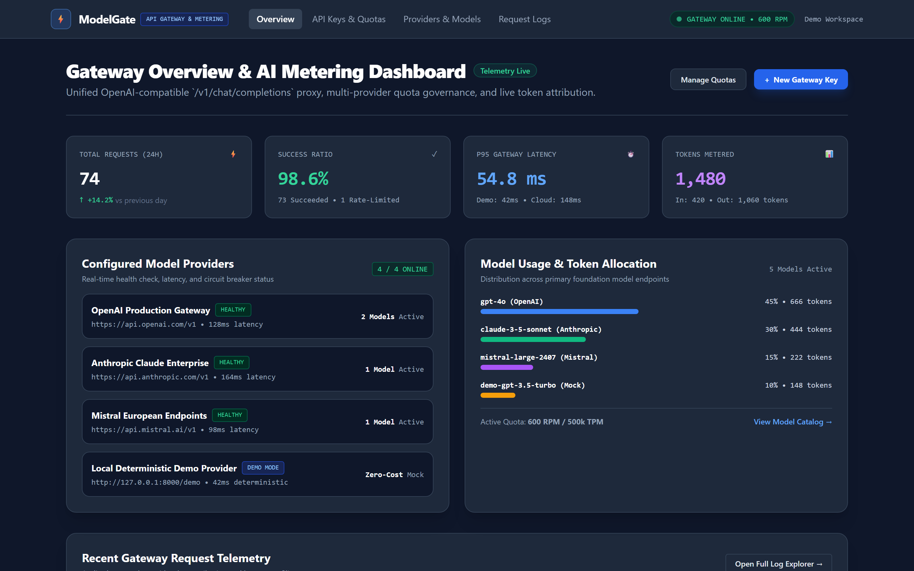
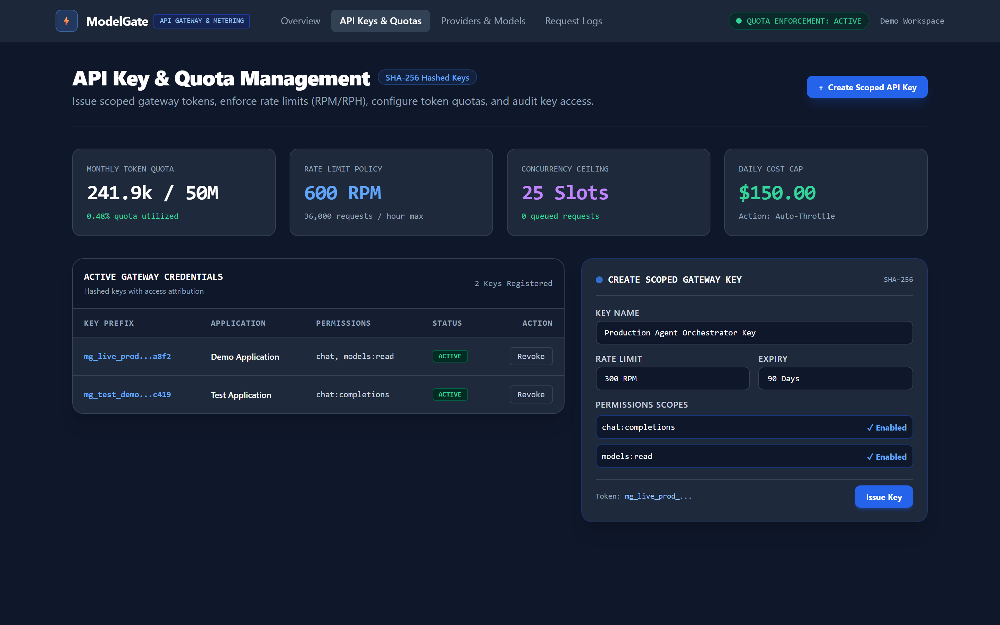
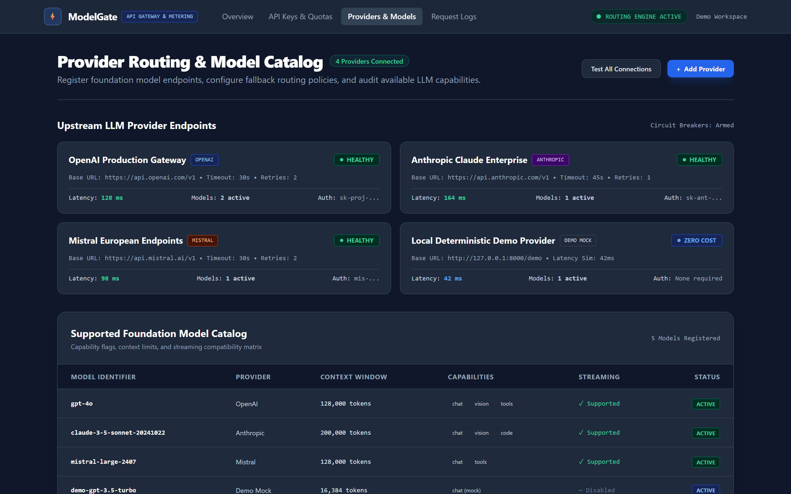
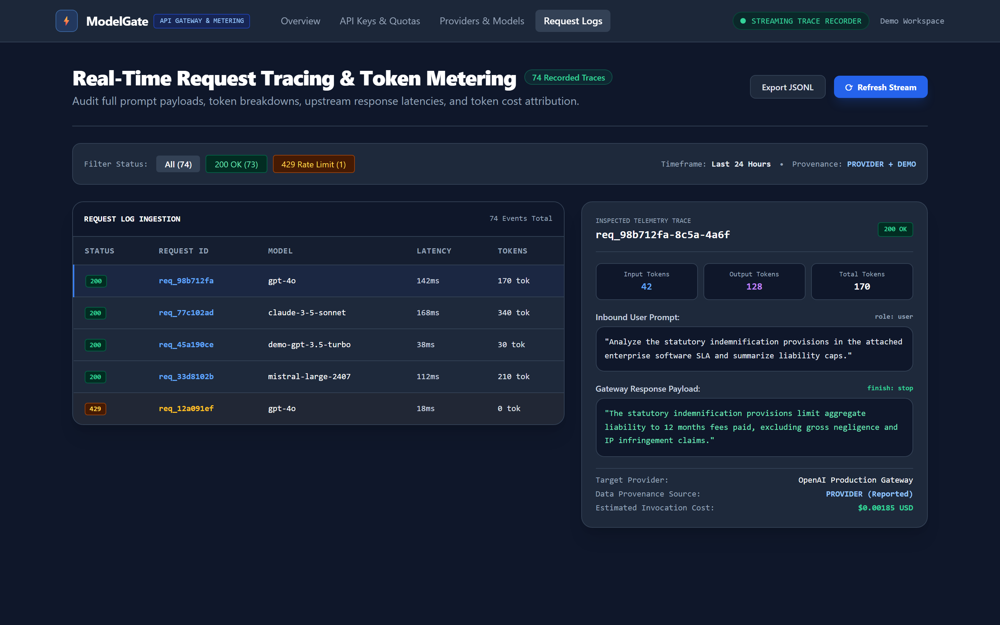

# ModelGate

**API Gateway & AI Usage Metering Platform**

Open-source unified API gateway for AI providers with usage metering, quotas, and analytics.

## Screenshots

### 1. Gateway Overview & AI Metering Dashboard
Dashboard metrik sentral menyajikan status telemetri API gateway multi-penyedia model secara *real-time*, memantau volume request harian (74 request dengan 98.6% success rate), latensi P95 perambatan (54,8 ms), total token yang termeterkan (1.480 token), status operasional penyedia upstream (OpenAI, Anthropic, Mistral, dan Demo Mock), alokasi persentase pemakaian model fondasi, serta tabel ringkasan telemetri transaksi terkini.



### 2. API Key & Quota Management
Antarmuka tata kelola kredensial dan pembatasan laju (*rate limiting*) memfasilitasi penerbitan gateway token berlingkup izin khusus (*scoped tokens*) dengan pengacakan SHA-256 yang aman, memantau utilisasi kuota token bulanan (241,9k dari 50M token), menetapkan batas request per menit (600 RPM / 36k RPH), mengontrol batas konkurensi (25 slot), serta mengotomatisasi tindakan proteksi anggaran harian (*auto-throttle*).



### 3. Provider Routing & Model Catalog
Katalog integrasi model dan perutean multi-penyedia menyajikan pemetaan komprehensif ke berbagai endpoint upstream AI (OpenAI Production Gateway, Anthropic Claude Enterprise, Mistral European Endpoints, dan Local Deterministic Demo Mock), menampilkan status kesehatan sirkuit pemutus (*circuit breaker armed*), ambang batas timeout, jendela konteks model (128k–200k tokens), serta kapabilitas multimodalitas dan streaming.



### 4. Real-Time Request Tracing & Token Metering
Panel investigasi jejak request dan akuntansi token menyajikan rekam jejak setiap transaksi inferensi secara rinci, dilengkapi filter kode status (200 OK dan 429 Rate Limit), visualisasi payload prompt masuk dan respon gateway keluar, dekomposisi token input/output, atribusi sumber data (*PROVIDER reported vs DEMO mock*), serta estimasi biaya per pemanggilan inferensi.



## Status

🚧 **Active Development** - MVP Phase  
✅ Milestone A Complete (Discovery, PRD, Architecture)  
✅ Milestone B In Progress (Gateway Foundation)

## Features (Implemented)

- ✅ **Unified API**: OpenAI-compatible `/v1/chat/completions` endpoint
- ✅ **Demo Provider**: Deterministic mock responses for testing
- ✅ **API Key Auth**: Secure SHA-256 hashed gateway keys
- ✅ **Usage Metering**: Token tracking with DEMO source labels
- ✅ **Database**: SQLite with SQLAlchemy ORM
- ✅ **Request Logging**: Full request/response recording

## Features (Planned)

- Rate limiting & quota enforcement
- Multiple provider adapters (OpenAI, custom)
- Model catalog & routing
- Analytics dashboard
- Provider health monitoring
- Retry/fallback logic

## Quick Start

### Backend Setup

```bash
cd backend
python -m venv venv
source venv/Scripts/activate  # Windows git-bash
pip install -e ".[dev]"
python seed_demo.py  # Creates demo workspace + API key
uvicorn app.main:app --reload
```

Server runs at http://localhost:8000

### Test Endpoint

```bash
# Use API key from seed_demo.py output
curl -X POST http://localhost:8000/v1/chat/completions \
  -H "Authorization: Bearer mg_..." \
  -H "Content-Type: application/json" \
  -d '{
    "model": "gpt-3.5-turbo",
    "messages": [{"role": "user", "content": "Hello"}],
    "temperature": 0.7
  }'
```

**Response:**
```json
{
  "id": "demo_abc123...",
  "object": "chat.completion",
  "created": 1697558400,
  "model": "demo-gpt-3.5-turbo",
  "choices": [{
    "index": 0,
    "message": {
      "role": "assistant",
      "content": "Hello! I'm a demo AI assistant..."
    },
    "finish_reason": "stop"
  }],
  "usage": {
    "prompt_tokens": 10,
    "completion_tokens": 20,
    "total_tokens": 30,
    "source": "DEMO"
  }
}
```

## Architecture

- **Backend**: FastAPI + SQLAlchemy + Pydantic
- **Database**: SQLite (local), PostgreSQL ready
- **Provider System**: Abstract adapter pattern
- **Auth**: Bearer token with SHA-256 hashing

## Project Structure

```
modelgate/
├── backend/
│   ├── app/
│   │   ├── api/v1/          # API routes
│   │   ├── db/              # Database models
│   │   ├── middleware/      # Auth middleware
│   │   ├── models/          # Pydantic schemas
│   │   ├── providers/       # Provider adapters
│   │   ├── utils/           # Crypto utilities
│   │   └── main.py          # FastAPI app
│   ├── seed_demo.py         # Demo data seeder
│   └── pyproject.toml
├── docs/                    # Design documentation
└── README.md
```

## Documentation

- [Repository Audit](docs/REPOSITORY_AUDIT.md)
- [PRD](docs/PRD.md) - Complete product requirements
- [UI/UX Brief](docs/UI_UX_BRIEF.md) - Dashboard design
- [Architecture](docs/ARCHITECTURE.md) - System design
- [Database Design](docs/DATABASE_DESIGN.md) - Schema details
- [Threat Model](docs/THREAT_MODEL.md) - Security analysis
- [Usage Accounting](docs/USAGE_ACCOUNTING.md) - Metering rules

## Roadmap

**✅ Milestone A - Discovery**
- [x] Repository audit
- [x] PRD with 90+ requirements
- [x] Complete architecture docs
- [x] Threat model
- [x] Usage accounting rules

**🔨 Milestone B - Gateway Foundation**
- [x] Database schema (9 tables)
- [x] Demo provider implementation
- [x] API key authentication
- [x] Chat completion endpoint
- [x] Request/usage recording
- [ ] Input validation tests
- [ ] Provider error handling

**Milestone C - Controls**
- [ ] Rate limiting (per-key, per-workspace)
- [ ] Quota enforcement (requests, tokens)
- [ ] Key management API (create, revoke, list)
- [ ] Workspace isolation tests

**Milestone D - Routing**
- [ ] Model catalog
- [ ] OpenAI provider adapter
- [ ] Provider health checks
- [ ] Retry/fallback logic

**Milestone E - Dashboard**
- [ ] Next.js frontend scaffolding
- [ ] Usage analytics charts
- [ ] Request logs UI
- [ ] API key management UI

**Milestone F - Hardening**
- [ ] Security audit implementation
- [ ] E2E Playwright tests
- [ ] Production deployment guide
- [ ] Performance optimization

## Development

### Run Tests
```bash
cd backend
pytest
```

### Code Quality
```bash
black .
ruff check .
mypy app/
```

### Database
```bash
# View current schema
sqlite3 modelgate.db .schema

# Reset database
rm modelgate.db
python seed_demo.py
```

## Security

- API keys hashed with SHA-256 (never stored plaintext)
- Bearer token authentication
- Workspace isolation enforced at query level
- Credentials redacted from logs
- SSRF protection planned for custom provider URLs

## Contributing

Project in active MVP development. Design feedback welcome. Code contributions after Milestone B completion.

## License

MIT (to be added)

---

**Built with**: FastAPI • SQLAlchemy • Pydantic • Next.js (planned)
